# Учёт личных финансов

Консольное приложение на Java для учёта доходов и расходов. Можно заводить категории, ставить на них бюджеты и смотреть статистику. Пользователей может быть несколько, у каждого свой кошелёк, данные сохраняются между запусками.

Итоговый проект по курсу ООП (МИФИ), задача от компании Promo IT.

## Как запустить

Нужен JDK 21. Gradle и библиотека Jackson (для JSON) скачаются при первой сборке.

```bash
./gradlew installDist
build/install/mephi-oop/bin/mephi-oop          # Linux и macOS
build\install\mephi-oop\bin\mephi-oop.bat      # Windows
```

Данные по умолчанию сохраняются в папку `data` там, откуда запущено приложение. Другую папку можно передать первым аргументом: `mephi-oop /путь/к/данным`.

Если в консоли Windows русские буквы отображаются неправильно, перед запуском выполните `chcp 65001`.

## Регистрация и вход

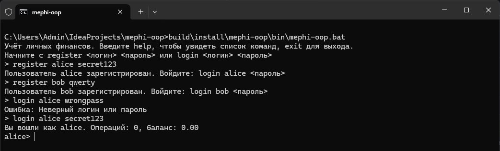

Регистрируемся, потом входим. С неверным паролем войти не получится.

## Доходы и расходы

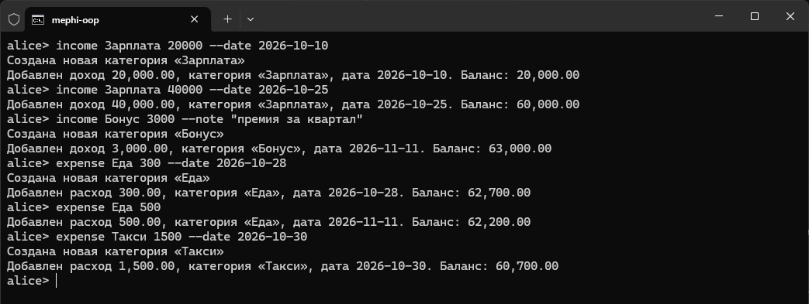

`income` добавляет доход, `expense` добавляет расход. Сначала пишется категория, потом сумма. Если категории ещё нет, она создаётся. Дату можно задать через `--date`, иначе будет сегодняшняя, а комментарий через `--note`.

## Бюджеты

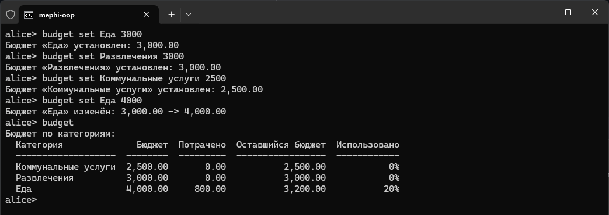

`budget set` ставит лимит на категорию. Если вызвать его ещё раз, лимит изменится. `budget` показывает все бюджеты с потраченной суммой и остатком.

## Оповещения

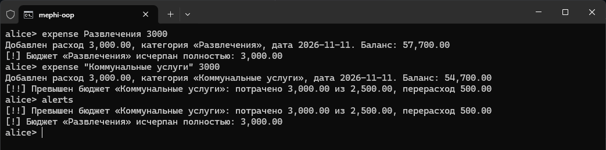

После расхода приложение предупреждает, если бюджет израсходован на 80%, закончился или превышен, а также если расходы стали больше доходов. `alerts` показывает все предупреждения сразу.

## Статистика

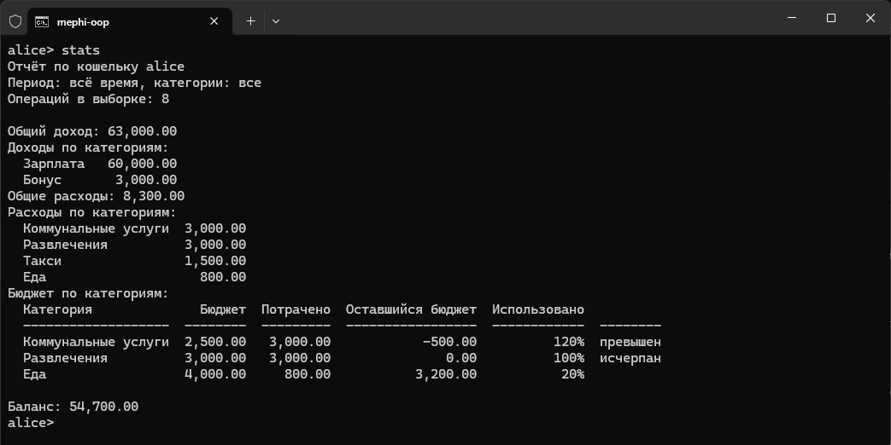

`stats` выводит общий доход и расходы, суммы по категориям, бюджеты с остатком и баланс. Здесь те же данные, что в примере из задания.

## Статистика по нескольким категориям

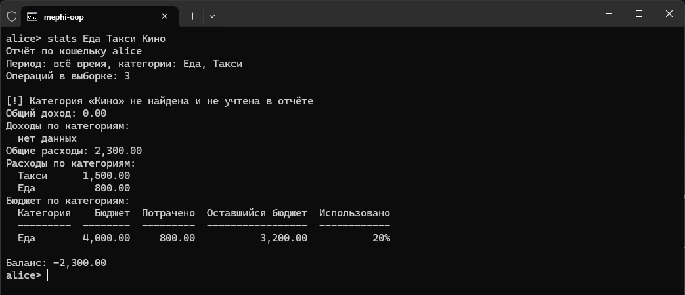

Если после `stats` перечислить категории, посчитаются только они. Про несуществующую категорию будет предупреждение.

## История операций

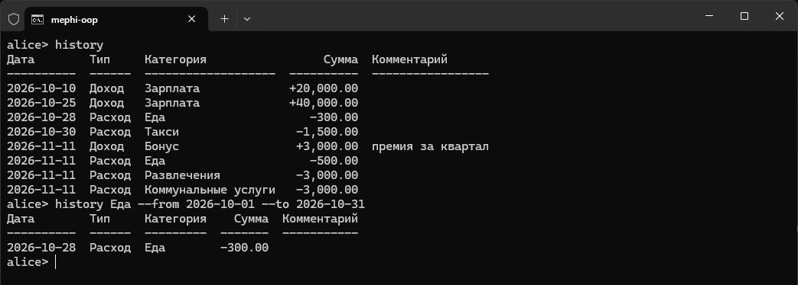

`history` показывает операции. Можно указать категории и период через `--from` и `--to`.

## Категории

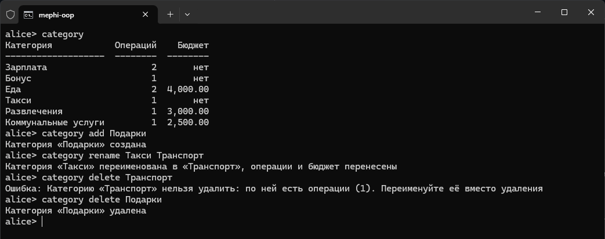

Категории можно смотреть, добавлять, переименовывать и удалять. При переименовании операции и бюджет переходят на новое название. Категорию, по которой уже есть операции, удалить нельзя.

## Переводы

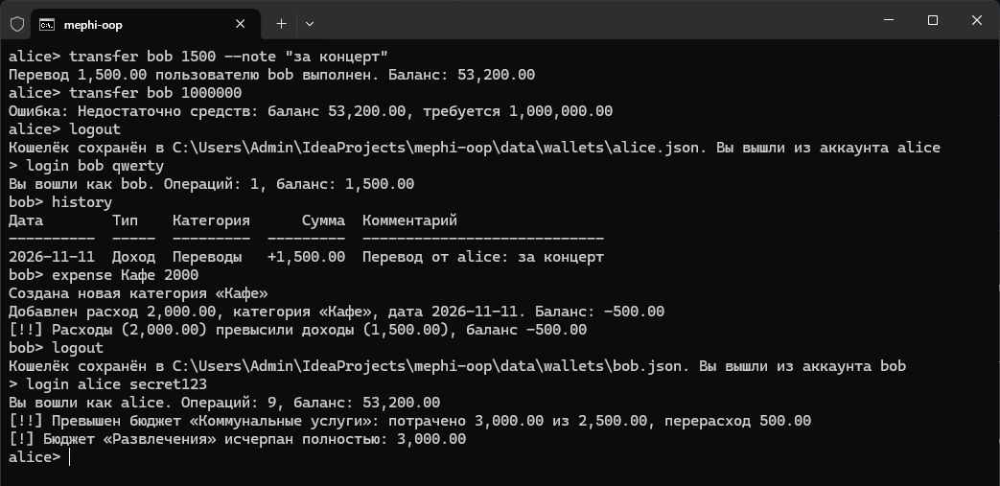

`transfer` переводит деньги другому пользователю: у отправителя записывается расход, у получателя доход. Перевести больше, чем есть на балансе, нельзя.

## Отчёт в файл, экспорт и импорт

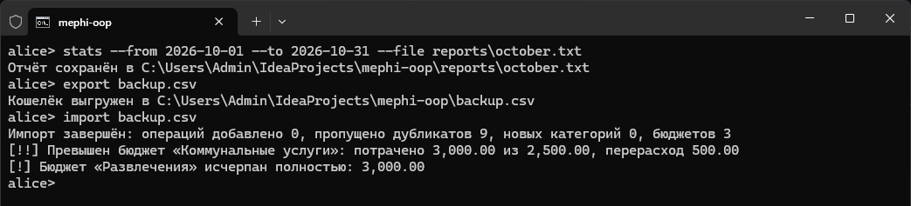

С `--file` отчёт сохраняется в файл. `export` выгружает кошелёк в JSON или CSV, `import` загружает обратно. Операции, которые уже есть, повторно не добавляются.

Так выглядит сохранённый отчёт за октябрь:

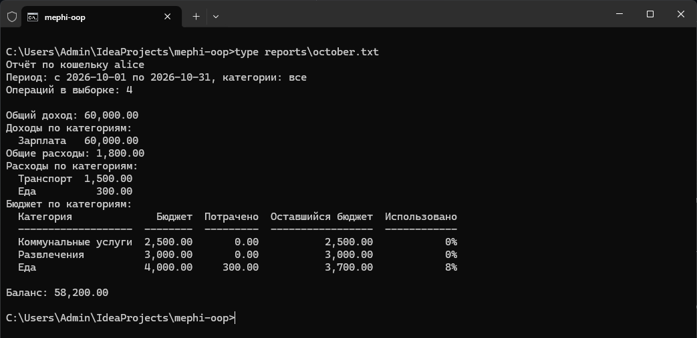

## Ошибки ввода

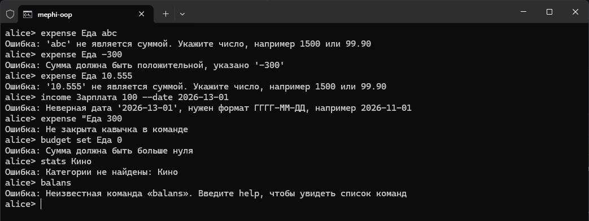

На неправильный ввод приложение выводит сообщение об ошибке и продолжает работу.

## Справка

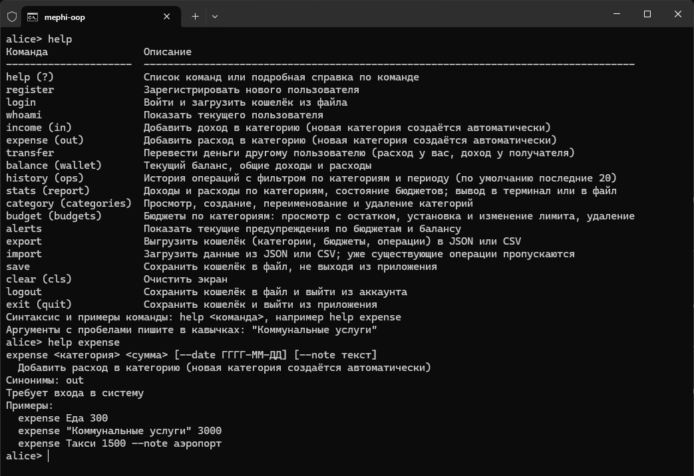

`help` выводит список команд, `help <команда>` показывает синтаксис и примеры.

## Сохранение между запусками

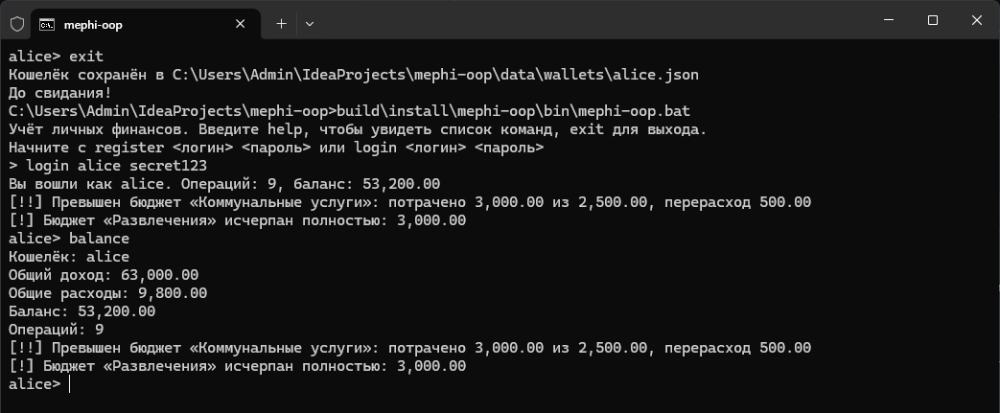

При выходе кошелёк сохраняется в файл, а при следующем входе загружается обратно.

## Команды

Названия с пробелами пишутся в кавычках, например `"Коммунальные услуги"`. В `income`, `expense` и `budget set` кавычки можно не ставить. Регистр в названиях категорий не важен. Суммы пишутся с точкой или запятой, даты в формате `ГГГГ-ММ-ДД`.

| Команда | Что делает |
|---|---|
| `register <логин> <пароль>` | регистрация |
| `login <логин> <пароль>` | вход и загрузка кошелька |
| `income <категория> <сумма> [--date] [--note]` | добавить доход |
| `expense <категория> <сумма> [--date] [--note]` | добавить расход |
| `transfer <логин> <сумма> [--note]` | перевод другому пользователю |
| `balance` | баланс, общие доходы и расходы |
| `stats [категории] [--from] [--to] [--file]` | статистика в терминал или в файл |
| `history [категории] [--from] [--to] [--limit]` | история операций |
| `category [list / add / rename / delete]` | категории |
| `budget [list / set / delete]` | бюджеты |
| `alerts` | текущие предупреждения |
| `export <файл>` | выгрузка в JSON или CSV |
| `import <файл>` | загрузка из JSON или CSV |
| `save` | сохранить кошелёк |
| `logout` | сохранить кошелёк и выйти из аккаунта |
| `exit` | сохранить кошелёк и закрыть приложение |
| `clear` | очистить экран |
| `help [команда]` | справка |
| `whoami` | кто сейчас вошёл |

## Где хранятся данные

Во время работы данные хранятся в памяти. Пользователи записываются в файл data/users.json при регистрации, пароли хранятся в виде хеша. Кошелёк каждого пользователя лежит в data/wallets/логин.json и сохраняется при выходе из приложения, при выходе из аккаунта, по команде save и при входе под другим пользователем. Кошелёк получателя перевода сохраняется сразу.

## Как устроен код

- domain: кошелёк, операции, пользователь и проверки сумм и названий
- service: вход, операции, переводы, категории и бюджеты, статистика, оповещения, экспорт и импорт; там же интерфейсы хранилищ
- infra: сохранение в JSON-файлы, форматы JSON и CSV, хеширование паролей
- cli: чтение команд, разбор ввода, отдельный класс на каждую команду

Запуск и сборка зависимостей находятся в `FinanceApp`.

## Тесты

```bash
./gradlew test
```

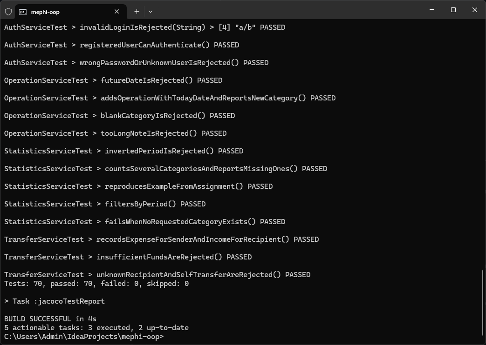

70 тестов. Кроме обычных unit-тестов есть `FinanceScenarioTest`: он запускает приложение и передаёт ему команды, в том числе пример из задания.

`./gradlew build` вместе с тестами проверяет стиль кода через Checkstyle и строит отчёт о покрытии в `build/reports/jacoco/test/html/index.html`, покрытие около 84%. Те же проверки запускаются в GitHub Actions при каждом push в `main`.
