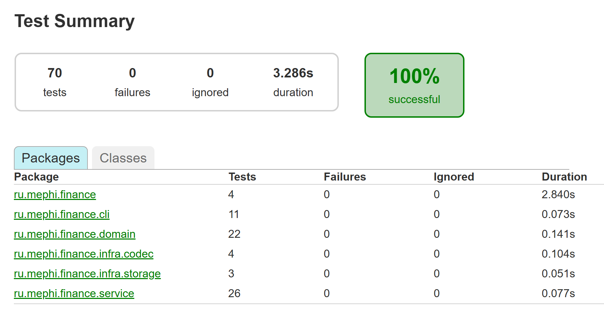
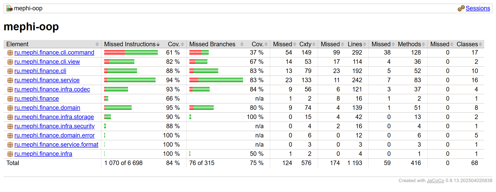

# Учёт личных финансов

Консольное приложение на Java, в котором можно вести свои доходы и расходы, ставить бюджеты на категории и смотреть, куда уходят деньги. Пользователей может быть несколько, у каждого свой кошелёк, и всё сохраняется между запусками.

Итоговый проект по курсу ООП (МИФИ), задача от компании Promo IT.

## Как запустить

Нужен JDK 21. Всё остальное (Gradle и библиотеку Jackson для JSON) сборка скачает сама.

```bash
./gradlew installDist
build/install/mephi-oop/bin/mephi-oop          # Linux и macOS
build\install\mephi-oop\bin\mephi-oop.bat      # Windows
```

Данные по умолчанию лежат в папке `data` рядом с местом запуска. Другую папку можно передать первым аргументом: `mephi-oop /путь/к/данным`.

Если в консоли Windows вместо русских букв появляются непонятные символы, выполните `chcp 65001` перед запуском.

## Регистрация и вход

Сначала регистрируемся, потом входим. Неверный пароль приложение не пропустит, а при входе загрузит кошелёк из файла.


## Доходы и расходы

`income` добавляет доход, `expense` добавляет расход: сначала категория, потом сумма. Если такой категории ещё нет, она создастся сама. Дату можно указать через `--date` (по умолчанию сегодня), а комментарий через `--note`.


## Бюджеты

`budget set` ставит лимит на категорию. Если вызвать его ещё раз для той же категории, лимит изменится. Просто `budget` показывает все бюджеты: сколько потрачено, сколько осталось и какой процент израсходован.


## Оповещения

Сразу после расхода приложение предупреждает, если бюджет почти кончился (80%), закончился ровно или уже превышен. Жёлтый `[!]` означает предупреждение, красный `[!!]` означает, что что-то пошло не так. Команда `alerts` показывает все текущие предупреждения разом.


## Общая статистика

`stats` показывает всё сразу: общий доход и расходы, суммы по каждой категории, бюджеты с остатком и итоговый баланс. Здесь те же данные, что в примере из задания, и цифры совпадают.


## Статистика по выбранным категориям

После `stats` можно перечислить категории, и посчитаются только они. Если какой-то категории нет, приложение скажет об этом, а остальные всё равно посчитает.


## История операций

`history` выводит операции таблицей. Их можно отфильтровать по категориям и по периоду через `--from` и `--to`.


## Категории

`category` показывает список категорий. Новую можно добавить, существующую переименовать (операции и бюджет переедут вместе с ней) или удалить. Категорию, по которой уже есть операции, удалить нельзя, чтобы не потерять историю.


## Переводы между пользователями

`transfer` переводит деньги другому пользователю по логину: у отправителя записывается расход, у получателя доход. Больше, чем есть на балансе, перевести нельзя. На скриншоте видно, что bob после входа уже видит перевод от alice. А когда его расходы превысили доходы, приложение сразу предупредило об этом.


## Отчёт в файл, экспорт и импорт

С опцией `--file` отчёт сохраняется в файл, а не выводится на экран (здесь отчёт только за октябрь). `export` выгружает весь кошелёк в JSON или CSV, а `import` загружает его обратно. Операции, которые уже есть в кошельке, при импорте не дублируются.


## Ошибки ввода

Если ввести что-то не то, приложение не падает: оно объясняет, что не так, и ждёт следующую команду.


## Справка

`help` выводит список всех команд, а `help <команда>` показывает её синтаксис и примеры.


## Сохранение между запусками

При выходе кошелёк сохраняется в файл. После повторного запуска и входа всё на месте: операции, категории, бюджеты и предупреждения.


## Шпаргалка по командам

Названия с пробелами пишутся в кавычках (`"Коммунальные услуги"`), хотя в `income`, `expense` и `budget set` кавычки можно не ставить. Регистр в названиях категорий не важен. Суммы пишутся с точкой или запятой, даты в формате `ГГГГ-ММ-ДД`.

| Команда | Что делает |
|---|---|
| `register <логин> <пароль>` | регистрация |
| `login <логин> <пароль>` | вход и загрузка кошелька |
| `income <категория> <сумма> [--date] [--note]` | добавить доход |
| `expense <категория> <сумма> [--date] [--note]` | добавить расход |
| `transfer <логин> <сумма> [--note]` | перевод другому пользователю |
| `balance` | баланс, общие доходы и расходы |
| `stats [категории] [--from] [--to] [--file]` | статистика, в терминал или в файл |
| `history [категории] [--from] [--to] [--limit]` | история операций |
| `category [list / add / rename / delete]` | категории |
| `budget [list / set / delete]` | бюджеты |
| `alerts` | текущие предупреждения |
| `export <файл>` / `import <файл>` | выгрузка и загрузка в JSON или CSV |
| `save`, `logout`, `exit` | сохранить; сохранить и выйти из аккаунта; сохранить и закрыть |
| `help [команда]`, `whoami` | справка; кто сейчас вошёл |

## Где хранятся данные

Пока приложение работает, всё лежит в памяти. В файлы данные пишутся так:

- `data/users.json`: логины и пароли. Пароли хранятся не открытым текстом, а в виде хеша PBKDF2 с солью. Файл обновляется при регистрации.
- `data/wallets/<логин>.json`: кошелёк пользователя. Записывается при `exit`, `logout`, `save` и при смене пользователя, а у получателя перевода сразу после перевода.

## Как устроен код

Код разделён на четыре слоя, каждый отвечает за своё:

- **`domain`**: сама модель. Кошелёк (`Wallet`) с категориями, бюджетами и операциями, а также правила вроде «сумма больше нуля» и «нельзя удалить категорию с операциями». Не знает ни про консоль, ни про файлы.
- **`service`**: то, что умеет приложение. Вход (`AuthService`), операции (`OperationService`), переводы (`TransferService`), категории и бюджеты (`CategoryService`), статистика (`StatisticsService`), оповещения (`AlertService`), экспорт и импорт (`PortabilityService`). Хранилища здесь описаны только интерфейсами в `service/port`.
- **`infra`**: реализации этих интерфейсов: хранение в JSON-файлах, форматы JSON и CSV, хеширование паролей.
- **`cli`**: всё, что связано с консолью: цикл чтения команд (`FinanceCli`), разбор ввода и по отдельному классу на каждую команду в `cli/command`.

Точка входа `FinanceApp` собирает всё вместе. Благодаря интерфейсам в тестах сервисы работают с хранилищами в памяти, а новый формат экспорта добавляется одним новым классом.

## Тесты

```bash
./gradlew test     # только тесты
./gradlew build    # тесты, проверка стиля (Checkstyle) и отчёт о покрытии
```

Всего 70 тестов. Unit-тесты проверяют кошелёк, сервисы, разбор ввода и работу с файлами. Интеграционные тесты в `FinanceScenarioTest` гоняют приложение целиком, как будто команды вводит человек: пример из задания, перезапуск, переводы, экспорт с импортом и ошибки ввода.



Тестами покрыто около 85% строк кода. Отчёт после сборки лежит в `build/reports/jacoco/test/html/index.html`, результаты тестов в `build/reports/tests/test/index.html`.



При каждом push в `main` GitHub Actions автоматически собирает проект и прогоняет тесты (`.github/workflows/build.yml`).
